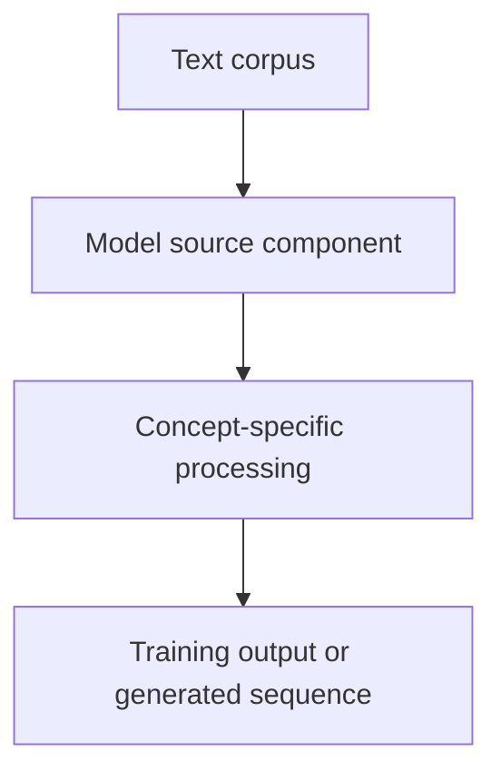

# Tiny GPT — Jetson + Colab — Query, Key and Value: Scaled Dot-Product Attention

## Linked concept
[TXT-170 — Query, Key and Value: Scaled Dot-Product Attention](../../concepts/text/170-query-key-value-scaled-dot-product-attention.md)

## Problem
TODO: supply the original requirement and why this concept was needed.

## Architecture
The source passes the same normalized hidden-state tensor as query, key and value to PyTorch MultiheadAttention. PyTorch performs the internal learned projections; the project file does not manually expose separate Q/K/V matrices.

## My exact contribution
TODO: supply the work you personally designed, coded, configured, tested, debugged or operated. Separate personal contribution from team work.

## Stack
Confirmed in inspected source: Python and PyTorch. TODO: supply exact versions, runtime and hardware details for this specific concept.

## Decisions & tradeoffs
TODO: supply your rationale, alternatives and tradeoffs. The source proves code structure, not why you personally selected it.

## Results/metrics
TODO: supply measured results, measurement method, dataset/sample size, environment, units and date. If none exist, state that clearly.

## What failed
TODO: supply failures, limitations and root causes. Do not invent failures.

## What I'd change
TODO: supply concrete improvements and why.

## Evidence links
- [Source: tiny_llm.py](https://github.com/SEVT-Logistics-Private-Limited/tiny-llm-jetson/blob/main/tiny_llm.py)
- Tests, commands and commits: TODO: supply.

## Link back
[Return to TXT-170 — Query, Key and Value: Scaled Dot-Product Attention](../../concepts/text/170-query-key-value-scaled-dot-product-attention.md)