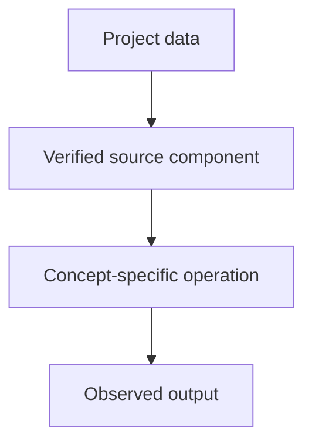

# Tiny GPT — Jetson + Colab — Static, Contextual and Positional Representations

## Linked concept
[TXT-110 — Static, Contextual and Positional Representations](../../concepts/text/110-static-contextual-and-positional-representations.md)

## Problem
TODO: supply the real requirement and why this concept was used. Do not infer missing context.

## Architecture
The model code includes a learned position embedding table and adds it to token embeddings. This verifies learned absolute positional representations. It does not implement or compare static Word2Vec and contextual embedding families.

## My exact contribution
TODO: supply what you personally designed, coded, configured, tested, debugged or operated. Separate your work from team work.

## Stack
Confirmed in inspected source: Python and PyTorch. TODO: supply exact versions, environment and hardware for this concept.

## Decisions & tradeoffs
TODO: supply actual choices, alternatives, rationale and tradeoffs.

## Results/metrics
TODO: supply measured results, method, dataset/sample size, environment, units and date. If none exist, say so.

## What failed
TODO: supply failures, limitations and root causes. Do not invent failures.

## What I'd change
TODO: supply concrete improvements and why.

## Evidence links
- [Source file](https://github.com/SEVT-Logistics-Private-Limited/tiny-llm-jetson/blob/main/tiny_llm.py)
- Test commands and reproducible results: TODO: supply.

## Link back
[Return to TXT-110 — Static, Contextual and Positional Representations](../../concepts/text/110-static-contextual-and-positional-representations.md)