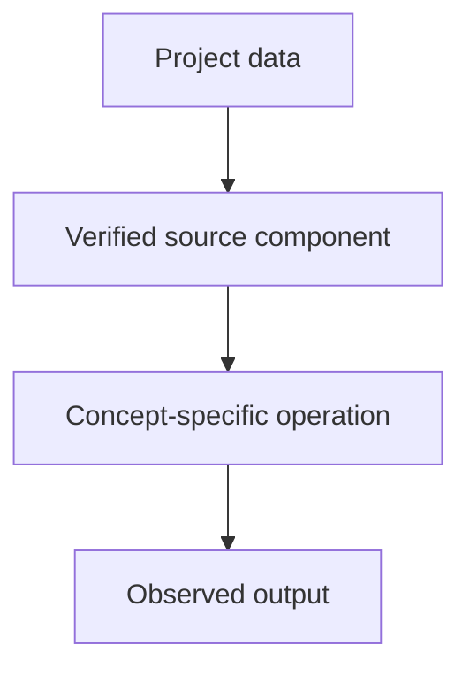

# Tiny GPT — Jetson + Colab — Text Embeddings

## Linked concept
[TXT-100 — Text Embeddings](../../concepts/text/100-text-embeddings.md)

## Problem
TODO: supply the real requirement and why this concept was used. Do not infer missing context.

## Architecture
TinyGPT defines self.tok and self.pos as torch.nn.Embedding layers. Its forward method looks up token IDs, adds learned position vectors and passes the representation through Transformer blocks. The output head shares weights with the token embedding.

## My exact contribution
TODO: supply what you personally designed, coded, configured, tested, debugged or operated. Separate your work from team work.

## Stack
Confirmed in inspected source: Python and PyTorch. TODO: supply exact versions, environment and hardware for this concept.

## Decisions & tradeoffs
TODO: supply actual choices, alternatives, rationale and tradeoffs.

## Results/metrics
TODO: supply measured results, method, dataset/sample size, environment, units and date. If none exist, say so.

## What failed
TODO: supply failures, limitations and root causes. Do not invent failures.

## What I'd change
TODO: supply concrete improvements and why.

## Evidence links
- [Source file](https://github.com/SEVT-Logistics-Private-Limited/tiny-llm-jetson/blob/main/tiny_llm.py)
- Test commands and reproducible results: TODO: supply.

## Link back
[Return to TXT-100 — Text Embeddings](../../concepts/text/100-text-embeddings.md)