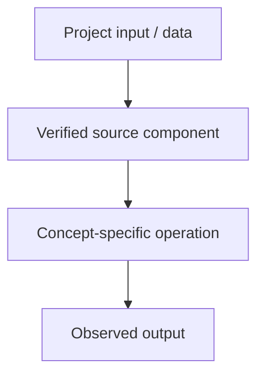

# Tiny GPT — Jetson + Colab — Tokenization: Character, Word and Subword Methods

## Linked concept
[TXT-070 — Tokenization: Character, Word and Subword Methods](../../concepts/text/070-tokenization-character-word-subword.md)

## Problem
TODO: supply the real requirement and why this concept was needed. Do not infer missing context.

## Architecture
The inspected training script creates a character vocabulary using sorted(set(text)), maps characters to integer IDs using stoi/itos and defines encode/decode functions. This is character-level tokenization, not BPE.

## My exact contribution
TODO: supply what you personally designed, coded, configured, tested, debugged or operated. Separate individual work from team work.

## Stack
Confirmed in inspected source: Python and PyTorch. TODO: supply exact versions, environment and hardware for this topic.

## Decisions & tradeoffs
TODO: supply actual choices, alternatives, rationale and tradeoffs.

## Results/metrics
TODO: supply measured results, method, data/sample size, environment, units and date. If none exist, state that clearly.

## What failed
TODO: supply bugs, failed experiments, limitations and root causes. Do not invent failures.

## What I'd change
TODO: supply concrete future changes and why.

## Evidence links
- [Source: tiny_llm.py](https://github.com/SEVT-Logistics-Private-Limited/tiny-llm-jetson/blob/main/tiny_llm.py)
- Test commands/results: TODO: supply.

## Link back
[Return to TXT-070 — Tokenization: Character, Word and Subword Methods](../../concepts/text/070-tokenization-character-word-subword.md)