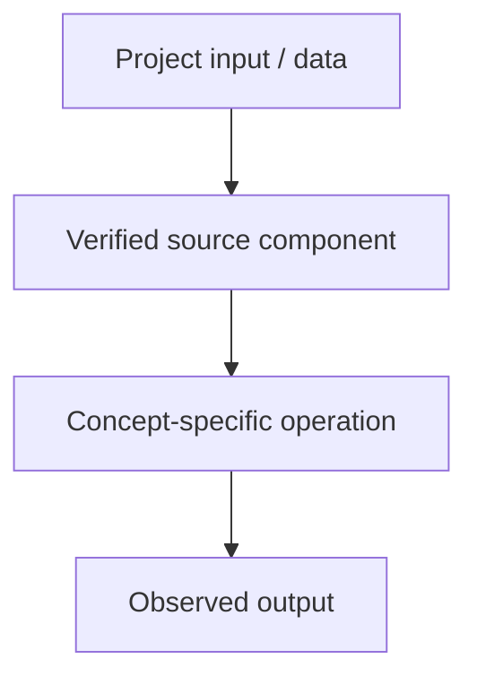

# Tiny GPT — Jetson + Colab — Unicode and UTF-8 Encoding / Decoding

## Linked concept
[TXT-040 — Unicode and UTF-8 Encoding / Decoding](../../concepts/text/040-unicode-and-utf8-encoding-decoding.md)

## Problem
TODO: supply the real requirement and why this concept was needed. Do not infer missing context.

## Architecture
The inspected Tiny GPT Telugu script loads Telugu corpus text into a Python string and iterates over characters to build a vocabulary. This demonstrates Unicode text handling in Python. The inspected script does not explicitly implement UTF-8 byte encoding or file decoding, so no such implementation is claimed.

## My exact contribution
TODO: supply what you personally designed, coded, configured, tested, debugged or operated. Separate individual work from team work.

## Stack
Confirmed in inspected source: Python and PyTorch. TODO: supply exact versions, environment and hardware for this topic.

## Decisions & tradeoffs
TODO: supply actual choices, alternatives, rationale and tradeoffs.

## Results/metrics
TODO: supply measured results, method, data/sample size, environment, units and date. If none exist, state that clearly.

## What failed
TODO: supply bugs, failed experiments, limitations and root causes. Do not invent failures.

## What I'd change
TODO: supply concrete future changes and why.

## Evidence links
- [Source: tiny_llm.py](https://github.com/SEVT-Logistics-Private-Limited/tiny-llm-jetson/blob/main/tiny_llm.py)
- Test commands/results: TODO: supply.

## Link back
[Return to TXT-040 — Unicode and UTF-8 Encoding / Decoding](../../concepts/text/040-unicode-and-utf8-encoding-decoding.md)