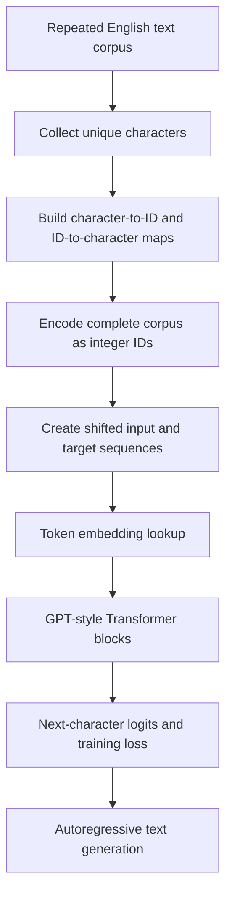

# Tiny GPT — Text Corpus and Character Representation

## Linked concept

[TXT-010 — What Is Text?](../../concepts/text/010-what-is-text.md)

## Problem

TODO: supply the original project problem statement and the reason this text representation approach was selected.

**What the source code demonstrates:** the repository contains a small GPT-style training script that creates a character vocabulary from a text corpus, maps characters to integer IDs and uses those IDs as model input.

## Architecture

Source-inspected flow from `tiny_llm.py`:

**Source evidence:** [tiny_llm.py](https://github.com/SEVT-Logistics-Private-Limited/tiny-llm-jetson/blob/main/tiny_llm.py)

## My exact contribution

TODO: supply which parts you personally designed, implemented, modified, tested or operated. The project README identifies an author, but this page does not infer your individual contribution from repository authorship alone.

## Stack

Confirmed from inspected source:
- Python.
- PyTorch (`torch`, `torch.nn`, `torch.nn.functional`).

TODO: supply exact Python/PyTorch versions, runtime environment and any other tools used for this specific experiment.

## Decisions & tradeoffs

**Observed implementation choices:**
- The script uses a character-level vocabulary generated from the corpus (`chars = sorted(set(text))`).
- `stoi` maps each character to an integer; `itos` maps the integer back to a character.
- `encode` and `decode` functions convert between text and ID sequences.
- The corpus is a repeated English sentence, making the small experiment easy to inspect.

**Engineering tradeoff (analysis, not attributed rationale):** character-level tokenization is straightforward and transparent, but sequences can be longer than subword-tokenized sequences. The script's vocabulary is limited to characters present in its training corpus; unseen characters cannot be handled by its direct dictionary lookup without additional logic.

TODO: supply why you chose this approach, alternatives considered and your own decision rationale.

## Results/metrics

Source/model-card references:
- The script calculates vocabulary size from the unique characters in the corpus at runtime.
- The repository's first model card documents a 13-character vocabulary for the tiny English experiment: [model-card.md](https://github.com/SEVT-Logistics-Private-Limited/tiny-llm-jetson/blob/main/model-card.md).
- The Telugu script separately builds a character vocabulary from the loaded Telugu corpus: [tiny_llm_telugu.py](https://github.com/SEVT-Logistics-Private-Limited/tiny-llm-jetson/blob/main/tiny_llm_telugu.py). Its model card documents a 245-character vocabulary: [model-card-telugu.md](https://github.com/SEVT-Logistics-Private-Limited/tiny-llm-jetson/blob/main/model-card-telugu.md).

These values are reported by the project documentation; this handbook has not independently rerun the training experiment.

TODO: supply your own verified run output, environment, date and any measurements you want to claim.

## What failed

TODO: supply text/data-specific bugs, unsupported-character cases, preprocessing issues or other failures encountered in this work.

## What I'd change

TODO: supply improvements you would make to the data and text representation pipeline, and explain why.

## Evidence links

- [Training script: tiny_llm.py](https://github.com/SEVT-Logistics-Private-Limited/tiny-llm-jetson/blob/main/tiny_llm.py)
- [Telugu training script: tiny_llm_telugu.py](https://github.com/SEVT-Logistics-Private-Limited/tiny-llm-jetson/blob/main/tiny_llm_telugu.py)
- [Project README](https://github.com/SEVT-Logistics-Private-Limited/tiny-llm-jetson#readme)
- [English tiny model card](https://github.com/SEVT-Logistics-Private-Limited/tiny-llm-jetson/blob/main/model-card.md)
- [Telugu model card](https://github.com/SEVT-Logistics-Private-Limited/tiny-llm-jetson/blob/main/model-card-telugu.md)

## Link back

[TXT-010 — What Is Text?](../../concepts/text/010-what-is-text.md)