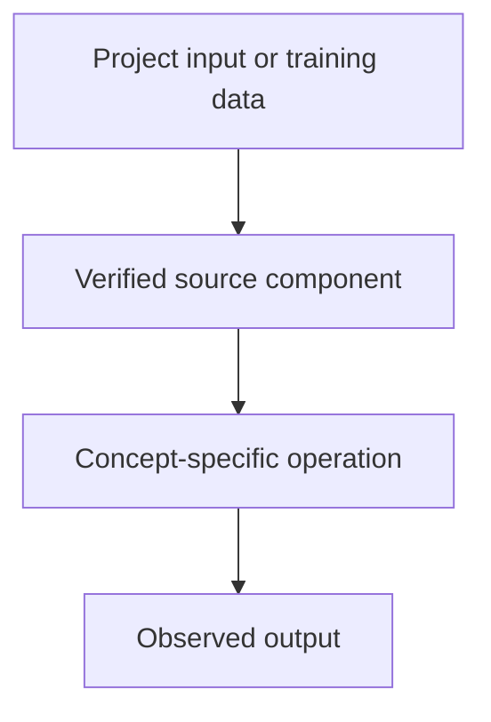

# TODO: supply project — Advanced RAG: Hybrid Search, Reranking and Query Transformation

## Linked concept
[TXT-290 — Advanced RAG: Hybrid Search, Reranking and Query Transformation](../../concepts/text/290-advanced-rag-retrieval-strategies.md)

## Problem
TODO: supply the real project requirement or engineering problem. Do not infer missing context.

## Architecture
No supplied project source currently verifies hybrid search, reranking, query rewriting or advanced retrieval. TODO: supply relevant repository paths, architecture, tests and your contribution.

## My exact contribution
TODO: supply what you personally designed, coded, configured, tested, debugged or operated. Separate your work from team work.

## Stack
TODO: supply actual languages, frameworks, models, services, storage, hardware and versions.

## Decisions & tradeoffs
TODO: supply decisions, alternatives, rationale and tradeoffs.

## Results/metrics
TODO: supply measured outcomes, method, sample size, environment, units and date. If none, state none.

## What failed
TODO: supply failures, limitations and root causes. Do not invent.

## What I'd change
TODO: supply concrete improvements and why.

## Evidence links
- Source files, tests, commits and architecture records: TODO: supply.
- Test commands and reproducible outputs: TODO: supply.

## Link back
[Return to TXT-290 — Advanced RAG: Hybrid Search, Reranking and Query Transformation](../../concepts/text/290-advanced-rag-retrieval-strategies.md)