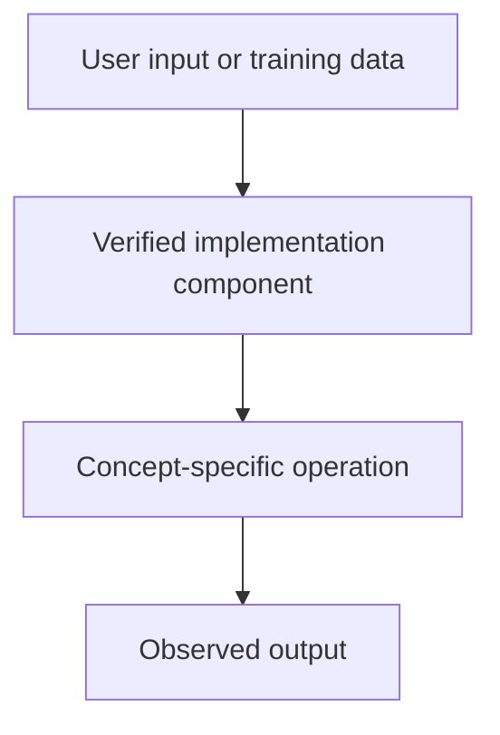

# TODO: supply project — BERT, T5 and Transformer Architecture Comparison

## Linked concept
[TXT-210 — BERT, T5 and Transformer Architecture Comparison](../../concepts/text/210-bert-t5-and-architecture-comparison.md)

## Problem
TODO: supply the actual problem or engineering requirement. Do not infer missing context.

## Architecture
No supplied project source demonstrates BERT or T5 implementation. TODO: supply a project if either architecture has been implemented or used.

## My exact contribution
TODO: supply your personal design, code, configuration, testing and debugging contributions, separate from team work.

## Stack
TODO: supply actual languages, frameworks, model providers, services and versions.

## Decisions & tradeoffs
TODO: supply decisions, alternatives considered and personal rationale.

## Results/metrics
TODO: supply measured outcomes, method, sample size, environment, units and date. If none, state none.

## What failed
TODO: supply failures, root causes and debugging evidence.

## What I'd change
TODO: supply improvements and rationale.

## Evidence links
- Source files, test runs, commits and architecture records: TODO: supply.

## Link back
[Return to TXT-210 — BERT, T5 and Transformer Architecture Comparison](../../concepts/text/210-bert-t5-and-architecture-comparison.md)