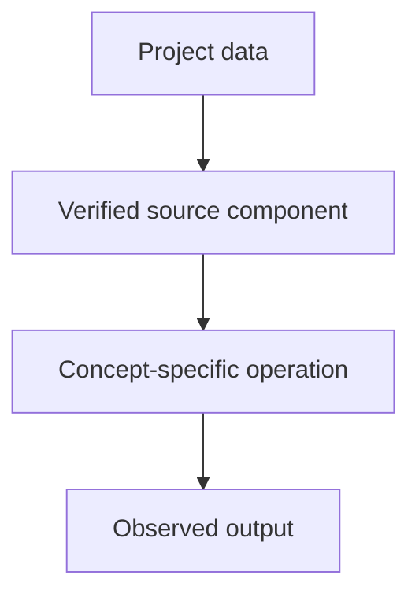

# TODO: supply project — N-Gram and Statistical Language Models

## Linked concept
[TXT-120 — N-Gram and Statistical Language Models](../../concepts/text/120-ngram-language-models.md)

## Problem
TODO: supply the real requirement and why this concept was used. Do not infer missing context.

## Architecture
No supplied project evidence currently demonstrates an n-gram language model. TODO: supply a project and exact source/test if one exists; otherwise keep this as conceptual learning only.

## My exact contribution
TODO: supply what you personally designed, coded, configured, tested, debugged or operated. Separate your work from team work.

## Stack
TODO: supply languages, frameworks, models, services, storage, hardware and versions actually used.

## Decisions & tradeoffs
TODO: supply actual choices, alternatives, rationale and tradeoffs.

## Results/metrics
TODO: supply measured results, method, dataset/sample size, environment, units and date. If none exist, say so.

## What failed
TODO: supply failures, limitations and root causes. Do not invent failures.

## What I'd change
TODO: supply concrete improvements and why.

## Evidence links
- Source files, tests and commits: TODO: supply.
- Test commands and reproducible results: TODO: supply.

## Link back
[Return to TXT-120 — N-Gram and Statistical Language Models](../../concepts/text/120-ngram-language-models.md)