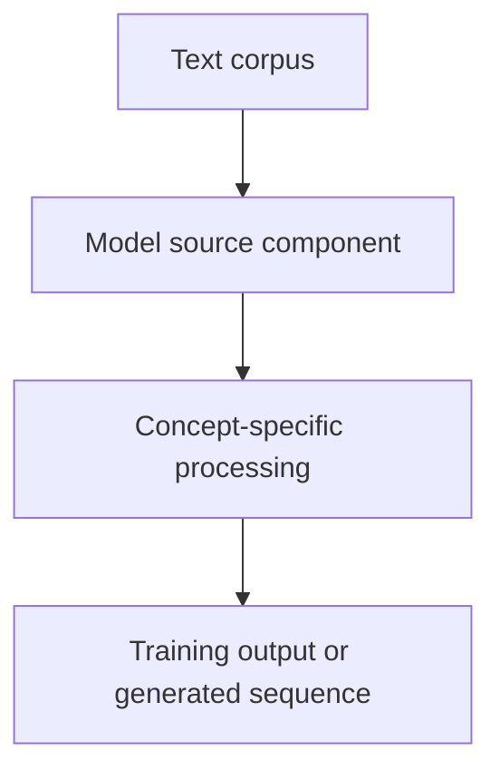

# Tiny GPT — Jetson + Colab — Sequence-to-Sequence Models and Teacher Forcing

## Linked concept
[TXT-140 — Sequence-to-Sequence Models and Teacher Forcing](../../concepts/text/140-sequence-to-sequence-and-teacher-forcing.md)

## Problem
TODO: supply the original requirement and why this concept was needed.

## Architecture
No supplied project source currently demonstrates an encoder-decoder seq2seq training path or teacher forcing. TODO: supply relevant repo and exact implementation if one exists.

## My exact contribution
TODO: supply the work you personally designed, coded, configured, tested, debugged or operated. Separate personal contribution from team work.

## Stack
Confirmed in inspected source: Python and PyTorch. TODO: supply exact versions, runtime and hardware details for this specific concept.

## Decisions & tradeoffs
TODO: supply your rationale, alternatives and tradeoffs. The source proves code structure, not why you personally selected it.

## Results/metrics
TODO: supply measured results, measurement method, dataset/sample size, environment, units and date. If none exist, state that clearly.

## What failed
TODO: supply failures, limitations and root causes. Do not invent failures.

## What I'd change
TODO: supply concrete improvements and why.

## Evidence links
- [Source: tiny_llm.py](undefined)
- Tests, commands and commits: TODO: supply.

## Link back
[Return to TXT-140 — Sequence-to-Sequence Models and Teacher Forcing](../../concepts/text/140-sequence-to-sequence-and-teacher-forcing.md)