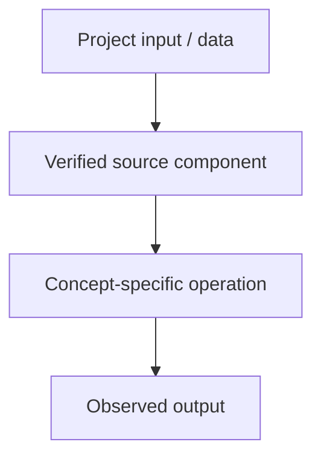

# TODO: supply project — Text Cleaning and Preprocessing

## Linked concept
[TXT-060 — Text Cleaning and Preprocessing](../../concepts/text/060-text-cleaning-and-preprocessing.md)

## Problem
TODO: supply the real requirement and why this concept was needed. Do not infer missing context.

## Architecture
TODO: supply an actual text preprocessing pipeline, exact contribution and tests. No project implementation is claimed.

## My exact contribution
TODO: supply what you personally designed, coded, configured, tested, debugged or operated. Separate individual work from team work.

## Stack
TODO: supply languages, frameworks, models, services, storage, hardware and versions actually used.

## Decisions & tradeoffs
TODO: supply actual choices, alternatives, rationale and tradeoffs.

## Results/metrics
TODO: supply measured results, method, data/sample size, environment, units and date. If none exist, state that clearly.

## What failed
TODO: supply bugs, failed experiments, limitations and root causes. Do not invent failures.

## What I'd change
TODO: supply concrete future changes and why.

## Evidence links
- Source files, tests, commits and architecture: TODO: supply.
- Test commands/results: TODO: supply.

## Link back
[Return to TXT-060 — Text Cleaning and Preprocessing](../../concepts/text/060-text-cleaning-and-preprocessing.md)