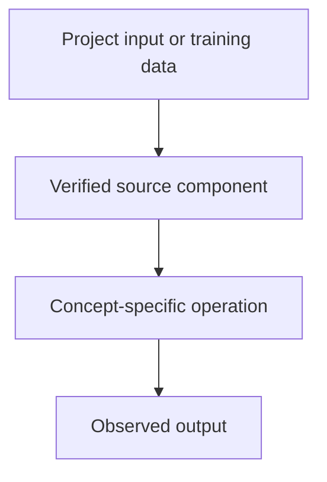

# YODA — Agentic Workflows — AI Agents: Tool Calling, Planning and Memory

## Linked concept
[TXT-300 — AI Agents: Tool Calling, Planning and Memory](../../concepts/text/300-agents-tool-calling-planning-memory.md)

## Problem
TODO: supply the real project requirement or engineering problem. Do not infer missing context.

## Architecture
The owner has identified YODA as an agentic workflow system. No YODA repository, agent roles, tool schemas, state model, workflow definitions or test evidence have been supplied. No agent implementation is claimed. TODO: supply repository and architecture.

## My exact contribution
TODO: supply what you personally designed, coded, configured, tested, debugged or operated. Separate your work from team work.

## Stack
TODO: supply actual languages, frameworks, models, services, storage, hardware and versions.

## Decisions & tradeoffs
TODO: supply decisions, alternatives, rationale and tradeoffs.

## Results/metrics
TODO: supply measured outcomes, method, sample size, environment, units and date. If none, state none.

## What failed
TODO: supply failures, limitations and root causes. Do not invent.

## What I'd change
TODO: supply concrete improvements and why.

## Evidence links
- Source files, tests, commits and architecture records: TODO: supply.
- Test commands and reproducible outputs: TODO: supply.

## Link back
[Return to TXT-300 — AI Agents: Tool Calling, Planning and Memory](../../concepts/text/300-agents-tool-calling-planning-memory.md)