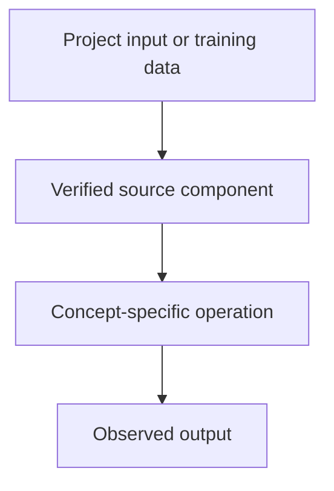

# YODA — Agentic Workflows — Multi-Agent Systems, Guardrails and Evaluation

## Linked concept
[TXT-310 — Multi-Agent Systems, Guardrails and Evaluation](../../concepts/text/310-multi-agent-systems-guardrails-evaluation.md)

## Problem
TODO: supply the real project requirement or engineering problem. Do not infer missing context.

## Architecture
YODA is identified by the owner as an agentic workflow system, but its repository and architecture have not yet been supplied. TODO: supply agent roles, interactions, tool permissions, state model, evaluation and your contribution.

## My exact contribution
TODO: supply what you personally designed, coded, configured, tested, debugged or operated. Separate your work from team work.

## Stack
TODO: supply actual languages, frameworks, models, services, storage, hardware and versions.

## Decisions & tradeoffs
TODO: supply decisions, alternatives, rationale and tradeoffs.

## Results/metrics
TODO: supply measured outcomes, method, sample size, environment, units and date. If none, state none.

## What failed
TODO: supply failures, limitations and root causes. Do not invent.

## What I'd change
TODO: supply concrete improvements and why.

## Evidence links
- Source files, tests, commits and architecture records: TODO: supply.
- Test commands and reproducible outputs: TODO: supply.

## Link back
[Return to TXT-310 — Multi-Agent Systems, Guardrails and Evaluation](../../concepts/text/310-multi-agent-systems-guardrails-evaluation.md)