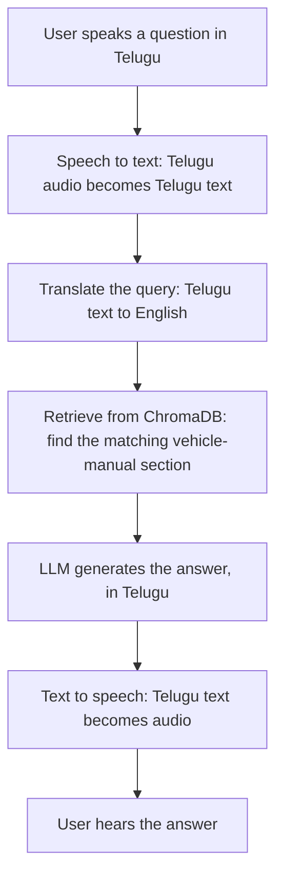

# My Project: Telugu Voice AI Assistant (Yodha)

[← Back to contents](../README.md)

**Live:** https://telugu-voice-app.gentletree-f4002f64.southindia.azurecontainerapps.io/assistant
**API docs:** https://telugu-voice-app.gentletree-f4002f64.southindia.azurecontainerapps.io/docs
**Code:** https://github.com/SEVT-Logistics-Private-Limited/tiny-llm-jetson

> Goal: learn what's going on behind the picture by building a real AI product end to end.

---

## What it does

You speak to it in Telugu, and it answers you back in Telugu, out loud. For vehicle questions, it answers using the vehicle manuals.

## How it works

| Step | What happens | Topic it uses |
|---|---|---|
| 1. User speaks | Browser records the question | – |
| 2. Speech → text | Telugu speech becomes Telugu text | Audio → numbers ([ch. 1](../docs/01-how-computers-understand-data.md)) |
| 3. Translate query | Telugu → English, because the manuals are in English | LLM ([ch. 3](../docs/03-text-and-llms.md#9-llms-and-gpt-style-models)) |
| 4. Retrieve from ChromaDB | Question → embedding → closest manual chunk | Embeddings, RAG ([ch. 3](../docs/03-text-and-llms.md#13-rag-retrieval-augmented-generation)) |
| 5. LLM answers | Prompt = Yodha's role + rules + manual text + question | Prompt engineering, RAG |
| 6. Text → speech | Telugu answer becomes audio | – |
| 7. User hears the answer | Then it listens again (continuous conversation) | – |

**Endpoints (REST API, FastAPI):** speech-to-text, chat and text-to-speech each run as API calls. See [ch. 7 (APIs)](../docs/07-apis.md#in-my-project).

---

## Tools I used

| Part | Tool |
|---|---|
| Speech → text | Browser speech recognition (Telugu), with Gemini as a backup |
| LLM | Google Gemini |
| Embeddings | `multilingual-e5-small` |
| Vector database | ChromaDB (vehicle manuals) |
| Text → speech | gTTS (Telugu) |
| API | FastAPI (Python) |
| Deployment | **Azure** (Container Apps), auto-deployed from GitHub |

> **Earlier version:** the first version used **Sarvam AI** for all three steps (Saarika speech-to-text, Sarvam-105b LLM, Bulbul text-to-speech) and translated the answer from English back to Telugu. I later switched to Gemini.

> **Note:** right now the live app reports its knowledge base as `disabled`, so it's answering without the manuals. The ChromaDB storage needs to be attached to the Azure app again.

---

## My own Telugu language model

Alongside the assistant, I trained my own small Telugu GPT model from scratch to understand how LLMs work inside:

| Setting | Value | Meaning |
|---|---|---|
| Transformer layers | **8** | One layer processes the input, and the next layer processes the updated result (attention + feed-forward) |
| Attention heads | **8** | 8 attention operations in parallel ([multi-head attention](../docs/03-text-and-llms.md#7-multi-head-attention)) |
| Context length | **128** | Max number of tokens the model can process together in one input |
| Vocabulary | 245 | One token per Telugu character |
| Parameters | ~25 million | |

Code: [`tiny_llm_telugu.py`](https://github.com/SEVT-Logistics-Private-Limited/tiny-llm-jetson/blob/main/tiny_llm_telugu.py). The plan is to eventually replace Gemini with my own model.

---

## Topics from this handbook used in this project

- ✅ [Tokens and tokenization](../docs/03-text-and-llms.md#2-tokens-and-tokenization)
- ✅ [Embeddings](../docs/03-text-and-llms.md#3-embeddings)
- ✅ [Transformer, attention heads, masking](../docs/03-text-and-llms.md#4-the-transformer)
- ✅ [LLMs](../docs/03-text-and-llms.md#9-llms-and-gpt-style-models)
- ✅ [Prompt engineering (role prompting)](../docs/03-text-and-llms.md#11-prompt-engineering)
- ✅ [Hallucination reduction](../docs/03-text-and-llms.md#12-hallucination)
- ✅ [RAG, chunking, retrieval](../docs/03-text-and-llms.md#13-rag-retrieval-augmented-generation)
- ✅ [Training loop: epochs, batches](../docs/02-ai-ml-deep-learning.md#how-a-model-learns-the-training-loop)
- ✅ [GPU](../docs/01-how-computers-understand-data.md#cpu-vs-gpu-the-hardware-that-does-the-work)
- ✅ [REST APIs](../docs/07-apis.md)
