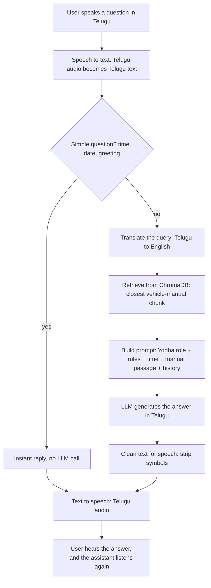
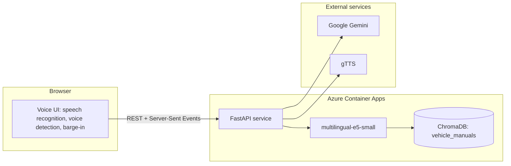
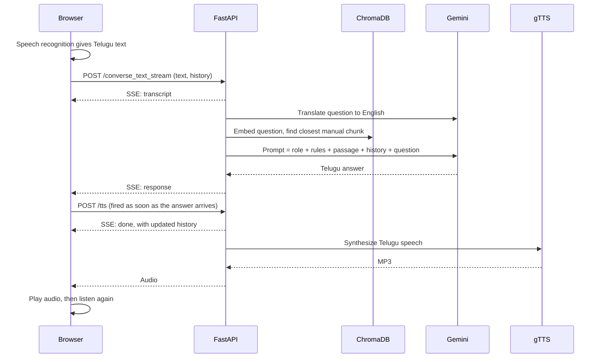
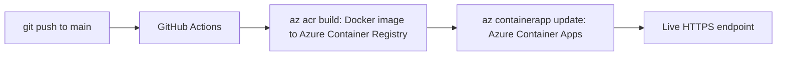

# Project: Telugu Voice AI Assistant (Yodha)

> A voice assistant that listens in Telugu, answers vehicle-service questions from the vehicle manuals using RAG, and replies out loud in Telugu. Built and deployed end to end to learn what happens behind the picture.

| | |
|---|---|
| **Live app** | [telugu-voice-app…azurecontainerapps.io/assistant](https://telugu-voice-app.gentletree-f4002f64.southindia.azurecontainerapps.io/assistant) |
| **API docs** | [`/docs`](https://telugu-voice-app.gentletree-f4002f64.southindia.azurecontainerapps.io/docs) |
| **Source code** | [SEVT-Logistics-Private-Limited/tiny-llm-jetson](https://github.com/SEVT-Logistics-Private-Limited/tiny-llm-jetson) |
| **Stack** | Python · FastAPI · Google Gemini · ChromaDB · multilingual-e5-small · gTTS · Docker · Azure Container Apps · GitHub Actions |

---

## Overview

The user speaks a question in Telugu. The assistant converts the speech to text, finds the relevant section of the vehicle manual, asks an LLM to answer using that section, and speaks the answer back in Telugu. Then it listens again for the next question.

  
   <em>The live assistant opens with a sign-in screen.</em>

## Request flow

| Step | What happens | Handbook topic |
|---|---|---|
| Speech → text | The browser's speech recognition (Telugu, `te-IN`) is the primary path. Gemini transcription is the server-side fallback. | [Computing Foundations](../../docs/01-computing-foundations/README.md) |
| Instant replies | Time, date and greetings are answered from a lookup table in under 100 ms | – |
| Translate the query | Telugu → English, because the manuals are in English | [Large Language Models](../../docs/03-language-models/05-large-language-models.md) |
| Retrieve | Query embedding (`multilingual-e5-small`) → ChromaDB → top-1 chunk, used only if `distance ≤ 0.35` | [Embeddings](../../docs/03-language-models/02-embeddings.md), [RAG](../../docs/03-language-models/08-retrieval-augmented-generation.md) |
| Prompt | Role ("You are Yodha…"), rules, current IST time, manual passage, last 8 turns | [Prompt Engineering](../../docs/03-language-models/06-prompt-engineering.md) |
| Generate | Gemini, with a fallback chain of models and a retry | [Large Language Models](../../docs/03-language-models/05-large-language-models.md) |
| Text → speech | gTTS (Telugu), with the browser's speech synthesis as fallback | – |

## System architecture

## API

The service is a FastAPI REST API (see the [APIs chapter](../../docs/05-apis/README.md)).

| Method | Endpoint | Purpose |
|---|---|---|
| `GET` | `/healthz` | Liveness check |
| `GET` | `/` | Status: version, time, knowledge-base state |
| `GET` | `/assistant` | Serves the voice assistant web page |
| `POST` | `/tts` | Text → Telugu speech |
| `POST` | `/converse` | Voice + history → transcript, answer, audio |
| `POST` | `/converse_stream` | Same as `/converse`, streamed as Server-Sent Events |
| `POST` | `/converse_text_stream` | Text + history → streamed answer (used by the UI) |
| `POST` | `/voice` | Single-turn voice in → voice out |

## Deployment

- The Docker image (`python:3.11-slim`) pre-downloads the embedding model, so retrieval never needs to download it at runtime.
- The Gemini API key is passed in from GitHub Actions secrets.

## My own Telugu language model

Alongside the assistant, I built GPT-style models **from scratch** to understand what happens inside an LLM:

| Setting | Telugu GPT | Meaning |
|---|---|---|
| Transformer layers | **8** | Each layer refines the previous layer's output (attention + feed-forward) |
| Attention heads | **8** | 8 parallel attention operations ([multi-head attention](../../docs/03-language-models/04-attention-mechanism.md)) |
| Context length | **128** | Maximum tokens processed together in one input |
| Embedding size | 512 | Length of each token's vector |
| Vocabulary | 245 | One token per Telugu character |
| Parameters | ~25 million | |
| Training data | `ai4bharat/samanantar` (50,000 Telugu sentences) | |

Before the Telugu model, the same architecture was scaled from **984 parameters to ~3 billion** on a toy English corpus, first on a Jetson Orin Nano and then on a Colab A100, to learn what changes with scale. The long-term goal is to replace Gemini with an in-house Telugu model.

Code: [`tiny_llm_telugu.py`](https://github.com/SEVT-Logistics-Private-Limited/tiny-llm-jetson/blob/main/tiny_llm_telugu.py) · [`tiny_llm.py`](https://github.com/SEVT-Logistics-Private-Limited/tiny-llm-jetson/blob/main/tiny_llm.py)

## Evolution

| Version | Speech → text | LLM | Text → speech | Hosting |
|---|---|---|---|---|
| Early | Sarvam Saarika | Sarvam-105b (answer translated back to Telugu) | Sarvam Bulbul | Azure VM |
| Current | Browser speech recognition, Gemini fallback | Gemini + RAG over vehicle manuals | gTTS, browser fallback | Azure Container Apps |

## Known limitations

- When the live service reports `"kb": "disabled"` at `GET /`, the vehicle-manual database isn't attached and answers aren't grounded in the manuals.
- Retrieval uses only the single closest chunk. Top-k retrieval with reranking would be more robust.
- gTTS is an unofficial service. A supported TTS API would be more reliable.

## Concepts used

[Tokenization](../../docs/03-language-models/01-tokenization.md) ·
[Embeddings](../../docs/03-language-models/02-embeddings.md) ·
[Transformer](../../docs/03-language-models/03-transformer-architecture.md) ·
[Attention & masking](../../docs/03-language-models/04-attention-mechanism.md) ·
[LLMs](../../docs/03-language-models/05-large-language-models.md) ·
[Prompt engineering](../../docs/03-language-models/06-prompt-engineering.md) ·
[Hallucination](../../docs/03-language-models/07-hallucination.md) ·
[RAG](../../docs/03-language-models/08-retrieval-augmented-generation.md) ·
[Training loop](../../docs/02-ai-fundamentals/README.md) ·
[GPUs](../../docs/01-computing-foundations/README.md) ·
[REST APIs](../../docs/05-apis/README.md)

---

[Home](../../README.md)
