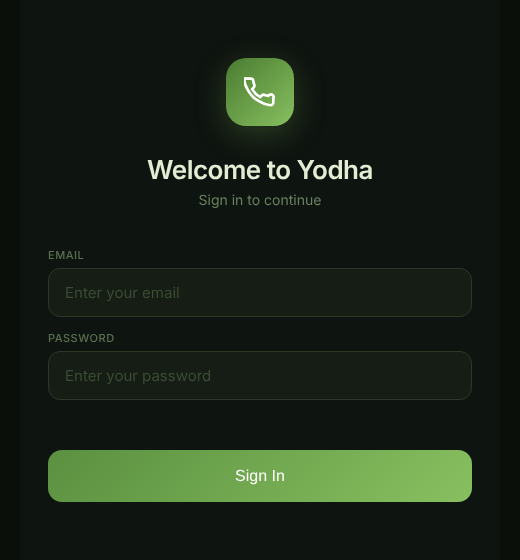
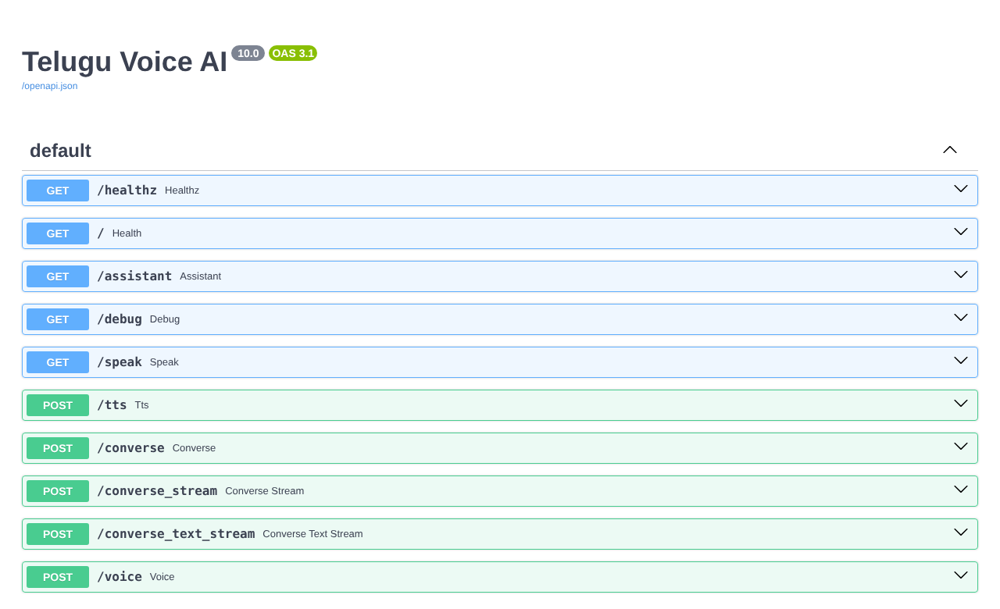

# Project: Telugu Voice AI Assistant (Yodha)

> A voice assistant that listens in Telugu, grounds its answers in vehicle manuals using RAG, and replies in spoken Telugu.

| Resource | Link |
|---|---|
| **Live app** | [Open the assistant](https://telugu-voice-app.gentletree-f4002f64.southindia.azurecontainerapps.io/assistant) |
| **API docs** | [`/docs`](https://telugu-voice-app.gentletree-f4002f64.southindia.azurecontainerapps.io/docs) |
| **Source code** | [tiny-llm-jetson](https://github.com/SEVT-Logistics-Private-Limited/tiny-llm-jetson) |
| **Built with** | Python, FastAPI, Google Gemini, ChromaDB, Docker, Azure |

<p align="center">
  
</p>

---

## What it does

The user speaks a question in Telugu. The assistant understands it, finds the relevant section of the vehicle manual, asks an LLM to answer, and speaks the answer back in Telugu. It then listens for the next question.

## How it works

```text
User speaks (Telugu)
        ↓
Speech to text
        ↓
FastAPI server receives the question
        ↓
Translate the query (Telugu text → English)
        ↓
RAG: retrieve the matching section from ChromaDB (vehicle manuals)
        ↓
LLM (Gemini) generates the answer using the manual section
        ↓
Text to speech (FastAPI: POST /tts)
        ↓
User hears the answer
```

| Step | What happens | Topic |
|---|---|---|
| Speech to text | Telugu speech becomes Telugu text | Audio (planned) |
| Translate the query | Telugu → English, because the manuals are in English | [LLM](../../docs/11-llm.md) |
| Retrieve from ChromaDB | Find the manual section that matches the question | [RAG](../../docs/13-rag.md) |
| LLM generates the answer | Gemini answers using the manual section, as "Yodha" | [LLM](../../docs/11-llm.md), [Prompt Engineering](../../docs/23-prompt-engineering.md) |
| Text to speech | The Telugu answer becomes audio | Audio (planned) |

## System overview

```text
                Browser (voice UI)
                       ↓  request
              FastAPI server on Azure
        ┌──────────────┼──────────────┐
        ↓              ↓              ↓
    ChromaDB      Google Gemini   Text to speech
(vehicle manuals)     (LLM)        (Telugu audio)
        └──────────────┼──────────────┘
                       ↓  response
                Browser plays the answer
```

## API endpoints

The assistant is a REST API built with [FastAPI](../../docs/15-fastapi.md).

| Method | Endpoint | What it does |
|---|---|---|
| GET | `/healthz` | Checks the server is running |
| GET | `/assistant` | Opens the voice assistant web page |
| POST | `/tts` | Text → Telugu speech |
| POST | `/converse` | Voice → answer as text and audio |
| POST | `/converse_text_stream` | Text → answer, sent back step by step |



## Deployment

```text
Push code to GitHub
        ↓
GitHub Actions builds the Docker image
        ↓
Image stored in Azure Container Registry
        ↓
Azure Container Apps runs the live app
```

Manual retrieval (RAG) reads a ChromaDB volume attached to the container. The service reports the state of that volume at `GET /` (`"kb": "loaded"` or `"kb": "disabled"`), so it can be verified after each deployment.

## In-house Telugu language model

We also built a small Telugu language model from scratch to understand how LLMs work internally:

| Setting | Value | Meaning |
|---|---|---|
| Transformer layers | 8 | One layer processes the input, then the next layer processes the updated result |
| Attention heads | 8 | 8 attention operations in parallel |
| Context length | 128 | Maximum number of tokens the model can process together in one input |
| Tokens (vocabulary) | 245 | One token per Telugu character |

See [Transformers](../../docs/22-transformers.md) and [Tokenization](../../docs/25-tokenization.md).

## Topics covered in this project

The project uses **13 of the 25 topics** in this handbook. Each topic page has an **"In our project"** section with the full details.

| # | Topic | Used? | How we used it |
|---|---|---|---|
| 1 | [CPU](../../docs/01-cpu.md) | Yes | The live server runs on CPU-only cloud machines (Azure), including the embedding model; audio sent as binary → base64 in JSON |
| 2 | [GPU](../../docs/02-gpu.md) | Yes | Trained our models on a Jetson Orin Nano and a Colab A100; 16-bit (bf16) numbers to halve memory; up to ~100% of GPU memory for the largest models |
| 3 | [Image](../../docs/03-image.md) | Not yet | Not used yet |
| 4 | [Image Resolution](../../docs/04-image-resolution.md) | Not yet | Not used yet |
| 5 | [Video](../../docs/05-video.md) | Not yet | Not used yet |
| 6 | [Frame](../../docs/06-frame.md) | Not yet | Not used yet |
| 7 | [FPS](../../docs/07-fps.md) | Not yet | Not used yet |
| 8 | [NLP](../../docs/08-nlp.md) | Yes | Telugu speech-to-text, keyword matching, translation, text cleanup, Telugu-script detection |
| 9 | [VLM](../../docs/09-vlm.md) | Not yet | Not used yet |
| 10 | [VLA](../../docs/10-vla.md) | Not yet | Not used yet |
| 11 | [LLM](../../docs/11-llm.md) | Yes | Gemini with a 3-model fallback chain; our own GPT models from 984 parameters to 3B |
| 12 | [ROS](../../docs/12-ros.md) | Not yet | Not used yet |
| 13 | [RAG](../../docs/13-rag.md) | Yes | Vehicle manuals in ChromaDB, e5 embeddings, top-1 chunk if distance ≤ 0.35 |
| 14 | [API](../../docs/14-api.md) | Yes | 8 REST endpoints of our own; we call the Gemini and gTTS APIs |
| 15 | [FastAPI](../../docs/15-fastapi.md) | Yes | The server: Pydantic validation, streaming (SSE), automatic `/docs` |
| 16 | [ML](../../docs/16-ml.md) | Yes | Rules for simple questions, learned models for everything else |
| 17 | [Supervised Learning](../../docs/17-supervised-learning.md) | Not directly | No classic classifier or regression model; our language models are self-supervised (predict the next character) |
| 18 | [Unsupervised Learning](../../docs/18-unsupervised-learning.md) | Not yet | Not used yet |
| 19 | [Semi-Supervised Learning](../../docs/19-semi-supervised-learning.md) | Not yet | Not used yet |
| 20 | [Reinforcement Learning](../../docs/20-reinforcement-learning.md) | Not yet | Not used yet |
| 21 | [DL](../../docs/21-dl.md) | Yes | Trained the Telugu model: batch 16, 10,000 steps, loss 331 → 1.42 |
| 22 | [Transformers](../../docs/22-transformers.md) | Yes | Our Telugu Transformer (8 layers, 8 heads, 128 context), e5 encoder, Gemini decoder |
| 23 | [Prompt Engineering](../../docs/23-prompt-engineering.md) | Yes | "Yodha" role prompt with rules, time, manual text and the last 8 messages |
| 24 | [Hallucination](../../docs/24-hallucination.md) | Yes | "Don't imagine" rules, RAG, relevance threshold, Telugu output check |
| 25 | [Tokenization](../../docs/25-tokenization.md) | Yes | Character tokenizer (245 Telugu tokens); output-token limits on Gemini |

How the topics connect inside the assistant:

```text
User speaks (NLP: speech to text)
        ↓
Browser → our REST API (API, FastAPI; audio sent as base64)
        ↓
Simple question? → rules → instant answer (ML vs rules)
        ↓ no
RAG: embeddings + ChromaDB (RAG, Transformers: e5 encoder)
        ↓
Prompt: Yodha role + rules + manual text (Prompt Engineering, Hallucination)
        ↓
Gemini generates the answer (LLM, Tokenization: token limits)
        ↓
Clean text → speech → user hears it (NLP)

Behind the scenes: our own Telugu model trained on a GPU (GPU, DL, Transformers, Tokenization)
                   live server runs on Azure CPUs (CPU)
```

---

[Home](../../README.md)
