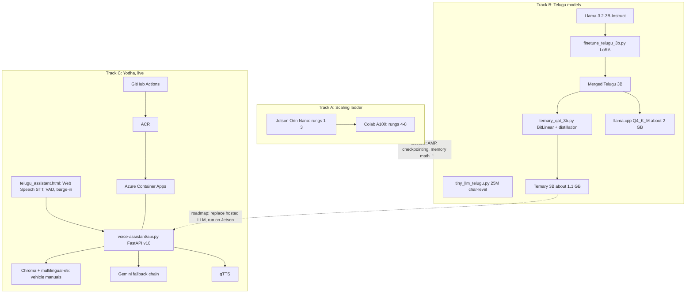

# Project Dossier: `tiny-llm-jetson` + Yodha Telugu Voice Assistant

**Repo:** https://github.com/SEVT-Logistics-Private-Limited/tiny-llm-jetson
**Pinned commit for this handbook:** [`9a7b564`](https://github.com/SEVT-Logistics-Private-Limited/tiny-llm-jetson/tree/9a7b564c8d764d1eff92218261f2fd2cef99099e)
**Owner:** Rishi Sasanala · Yodha AI (SEVT Logistics Private Limited)
**Hardware:** Jetson Orin Nano Super · Colab Pro A100-SXM4-80GB
**Live:** `https://52.140.52.237.nip.io/assistant`
**Checkpoints:** [huggingface.co/RishikUttejSasanala](https://huggingface.co/RishikUttejSasanala)

---

## 1. What the project is

Three tracks that converge on one product goal: **a Telugu voice assistant running on our own model, eventually offline on the edge.**

| Track | Question it answers | Status |
|---|---|---|
| **A. Scaling ladder** | Can we build and train a GPT from scratch, and how far can each hardware tier go? | ✅ 984 params → 3.07B |
| **B. Telugu language** | Can our model speak Telugu? Can we adapt and compress a real 3B for Telugu? | ✅ 25M scratch model. 🟡 LoRA + ternary pipeline built, results pending. |
| **C. Yodha voice assistant** | Can a Telugu speaker hold a grounded voice conversation today? | ✅ Live (hosted LLM + RAG) |

## 2. System architecture

## 3. Repository map

| Path | Purpose |
|---|---|
| `tiny_llm.py`, `tiny_llm_1m.py`, `_150m`, `_400m`, `_1b`, `_2b`, `_3b`, `_5b` | Scaling ladder training scripts. Same GPT, different config. (`_5b` is actually 3.07B.) |
| `test_tiny_llm*.py` | Independent reload + generate verification |
| `tiny_llm_telugu.py` | Rung 9: 25M Telugu char-level GPT on samanantar |
| `model-card*.md` | Per-rung results, failures, interpretation |
| `compression/finetune_telugu_3b.py` | LoRA SFT on Telugu Q&A (answer-only loss, text mixing, resumable) |
| `compression/ternary_qat_3b.py` | Ternary QAT + KL distillation + 2-bit packing + eval |
| `compression/test_*.py` | CPU unit tests with tiny random models |
| `voice-assistant/api.py` | **Current** production API (v10) |
| `voice-assistant/telugu_assistant.html` | **Current** voice UI |
| `voice-assistant/Dockerfile`, `requirements.txt` | Container build |
| `.github/workflows/deploy.yml` | CI/CD to Azure Container Apps |
| `telugu_voice_api.py`, root `telugu_assistant.html` | **Legacy** v8 (all-Gemini incl. Gemini TTS) |

## 4. Topic → project cross-reference

| Handbook topic | What we did |
|---|---|
| [00.2 Text](../docs/00-foundations/02-text.md) | Telugu Unicode-range detection for TTS cleaning and eval |
| [00.4 Audio](../docs/00-foundations/04-audio.md) | WebM capture, spectral-energy VAD, PCM → WAV |
| [00.6 ML fundamentals](../docs/00-foundations/06-ml-fundamentals.md) | lr vs width lessons, memorization vs learning |
| [01.1 Tokenization](../docs/01-text/01-tokenization.md) | Char-level tokenizers (V=13, V=245), Llama chat templates |
| [01.2 Embeddings](../docs/01-text/02-embeddings.md) | Learned token + position embeddings, weight tying, e5 sentence embeddings |
| [01.3 Transformer](../docs/01-text/03-attention-transformer.md) | Pre-norm causal GPT block, one class from 984 → 3B |
| [01.4 Training & scaling](../docs/01-text/04-llm-training-scaling.md) | 9-rung ladder, bf16 + checkpointing + clipping |
| [01.5 Decoding](../docs/01-text/05-decoding-inference.md) | Multinomial sampling, greedy eval, max_tokens, instant replies |
| [01.6 LoRA](../docs/01-text/06-fine-tuning-lora.md) | r=64 LoRA on 7 projections, answer-only loss |
| [01.7 Compression](../docs/01-text/07-quantization-compression.md) | BitLinear ternary QAT, distillation, 2-bit packing, GGUF |
| [01.8 Prompting](../docs/01-text/08-prompt-engineering.md) | Yodha persona, live IST context, system-as-turn workaround |
| [01.9 RAG](../docs/01-text/09-rag.md) | Vehicle-manual RAG: translate → e5 → Chroma top-1 → threshold → inject |
| [01.10 Evaluation](../docs/01-text/10-evaluation.md) | Held-out answer loss, Telugu-script %, perplexity of the packed model |
| [02.1 STT](../docs/02-audio/01-speech-to-text.md) | Sarvam → Gemini → Web Speech API primary |
| [02.2 TTS](../docs/02-audio/02-text-to-speech.md) | Bulbul → Gemini TTS → gTTS + browser fallback |
| [02.3 Voice agents](../docs/02-audio/03-voice-agents.md) | Conversation loop, SSE, barge-in, overlapped TTS |
| [05.1 Multimodal](../docs/05-multimodal/01-multimodal-models.md) | Gemini consumes audio inline and generates audio |
| [06.1 Hardware](../docs/06-systems/01-gpu-memory-hardware.md) | Jetson unified-memory crash fix, A100 3.07B ceiling |
| [06.2 Serving](../docs/06-systems/02-serving-apis.md) | FastAPI, fallback chain, SSE, `/debug` |
| [06.3 Deployment](../docs/06-systems/03-deployment-mlops.md) | VM + systemd + Nginx → Docker + ACR + Container Apps CI/CD |
| [06.4 Reliability & security](../docs/06-systems/04-reliability-security.md) | Fallback ladder. Audit findings (auth, CORS, `/debug`). |

## 5. Timeline (from repo evidence)

1. **Rungs 1–3 on Jetson:** pipeline proof. A 1000× scale-up memorizes flawlessly. 150M fails to converge (lr) and hits a unified-memory allocator crash.
2. **Rungs 4–8 on A100:** bf16 + gradient checkpointing + clipping. 3.07B is the hardware ceiling.
3. **Rung 9:** first real language (Telugu, 25M, loss 1.42).
4. **Voice assistant v1–v4.2:** Sarvam STT/LLM/TTS on an Azure VM. Instant cache, IST context, VAD, mobile autoplay fix. Conversational fine-tune on IndicVault (93k samples, loss 2.17 → 0.76).
5. **v8:** all-Gemini (STT, LLM, TTS).
6. **v10 (current):** browser STT, Gemini fallback chain, gTTS, **RAG over vehicle manuals**, SSE, barge-in, Container Apps CI/CD.
7. **Compression track:** LoRA → ternary QAT pipeline with tests (Colab-only, results pending).

## 6. Known discrepancies (README vs code)

| README says | Code says |
|---|---|
| Pipeline: Sarvam Saarika → Sarvam-105b → Bulbul | v10 uses Web Speech / Gemini STT → Gemini LLM chain → gTTS |
| Silence threshold raised 12 → 25 | `avg > 12` in `telugu_assistant.html` |
| Endpoints include `POST /speak` and `POST /stt` | `/speak` is `GET` (greeting test). There's no `/stt`. Added `/converse_stream`, `/converse_text_stream`, `/healthz`, `/debug`. |
| Rung 8 "5b" | 3,072,828,000 params (3.07B) |
| Infrastructure: Azure VM + systemd + Nginx | CI deploys to Azure Container Apps |

Recommendation: update the project README to describe the v10 architecture, and keep a CHANGELOG.

## 7. Next steps (engineering view)

1. **Run and record** the LoRA and ternary QAT pipelines. Publish held-out loss, Telugu %, perplexity and size in a results table.
2. **Close the loop:** serve the merged Telugu 3B (GGUF Q4 first, ternary later) behind the same `telugu_llm()` interface, and A/B test it against Gemini.
3. **Latency:** stream LLM tokens → sentence-chunked TTS. Add per-stage timing to the SSE `done` event.
4. **Refactor** the duplicated endpoint logic into one `answer_turn()` service.
5. **Security:** auth + rate limiting, lock down `/debug` and CORS, use secret refs.
6. **RAG:** version the ingestion script, use top-3 + reranking, and build a retrieval eval set.
7. **Edge:** run the Q4/ternary 3B on the Jetson Orin Nano (llama.cpp CUDA) for offline mode.
