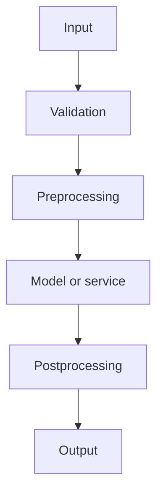
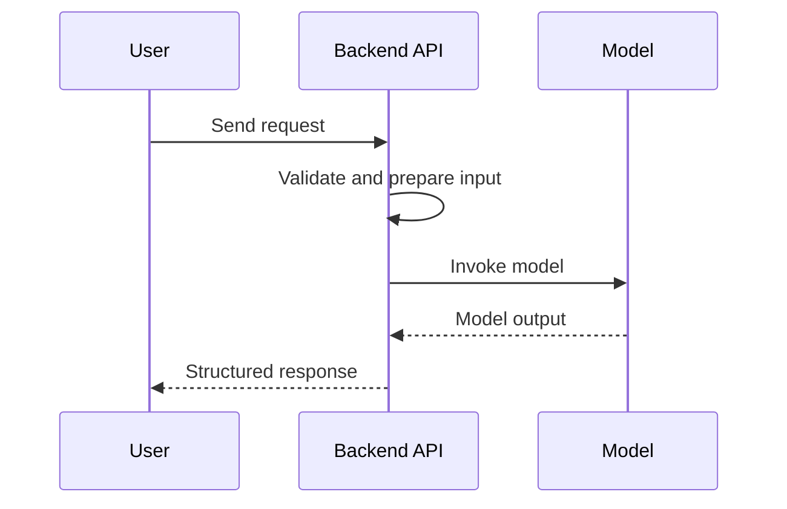

# Diagram conventions

Use Mermaid for diagrams that should remain editable in Markdown.

## Generic data flow

## Request/response sequence

Label external services, data stores, trust boundaries and asynchronous steps explicitly. Avoid implying a component exists in a project until it is verified.
