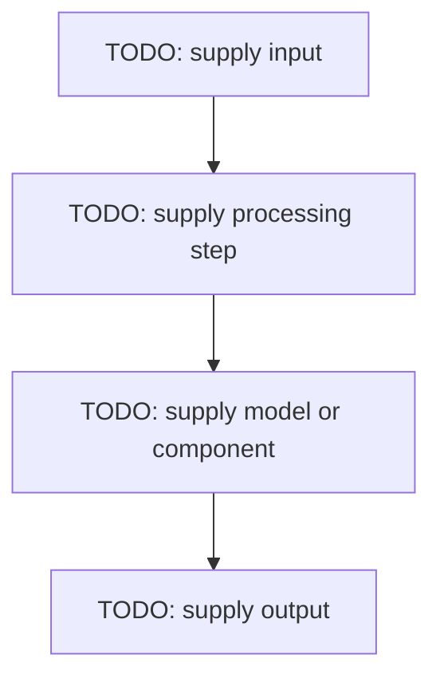

# TODO: supply concept title

## Definition
TODO: supply a plain-language definition. State what it is and what problem it solves.

## How it is represented
TODO: supply the formats, structures, symbols, tensors, vectors, tokens, frames or signal representations involved.

## Processing pipeline
TODO: supply the ordered steps. Add a Mermaid flow diagram with inputs, transformations, model/component boundaries and outputs.

## Key models
TODO: supply relevant model families, architectures or algorithms. Distinguish general concepts from model-specific behavior.

## I/O modes
TODO: supply supported input → output combinations (for example: text → text, audio → text, text → audio, image + text → text).

## Failure modes
TODO: supply common failure modes, edge cases, limitations, data-quality issues and evaluation risks.

## Further reading
- TODO: supply official documentation.
- TODO: supply primary research or authoritative reference.

## Related project evidence
- TODO: supply relative link to each project-evidence page for this concept.
- If none exists, write: `No project implementation claimed yet.`