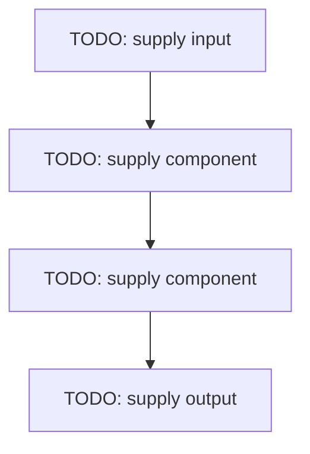

# TODO: supply project name — concept

## Linked concept
TODO: supply relative link to exactly one primary concept page.

## Problem
TODO: supply the real problem, user need or engineering requirement. Do not infer missing context.

## Architecture
TODO: supply architecture diagram and end-to-end data flow. Identify component boundaries and data contracts.

## My exact contribution
TODO: supply what you personally designed, coded, configured, tested or operated. Separate individual work from team work.

## Stack
TODO: supply languages, frameworks, models, services, hardware, storage and versions actually used.

## Decisions & tradeoffs
TODO: supply decisions, alternatives considered and tradeoffs (quality, latency, cost, complexity, privacy, hardware).

## Results/metrics
TODO: supply measured results, method, dataset/sample size, environment, units and date. If none exist, say so.

## What failed
TODO: supply failures, bugs, limitations, rejected experiments and root causes.

## What I'd change
TODO: supply concrete improvements and why they would help.

## Evidence links
- Source files/functions: TODO: supply.
- Tests or reproducible runs: TODO: supply.
- Commits, pull requests or design records: TODO: supply.
- Screenshots or sanitized examples: TODO: supply.

## Link back
TODO: supply a relative link to the related concept page. Keep the link bidirectional.